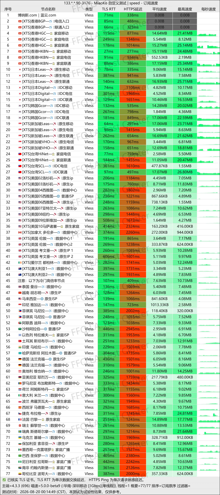
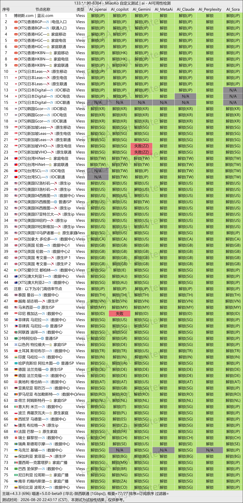
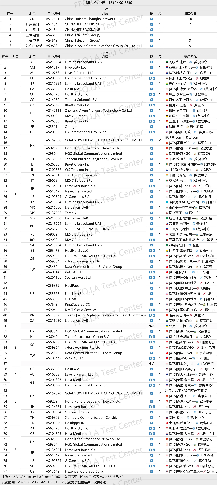

🇨🇳 [中文](README.md) | 🇺🇸 English | 🇷🇺 [Русский](README_RU.md) | 🇮🇷 [فارسی](README_FA.md)

# LanYun VPN Official Website (Updated November 14, 2026)

Official LanYun VPN Website<br>
Latest URL 01: [https://lanyun.org](https://to.iix.im/lan01)<br>
Latest URL 02: [https://lanyun.xyz](https://to.iix.im/lan02)<br>
Official URL 01: [https://蓝云.com](https://to.iix.im/lan03)<br>
Official URL 02: [https://博纳斯.com](https://to.iix.im/lan04)<br>

Best VPN Recommendations and Server List for 2026: [https://github.com/jdnei/JiChangTuiJian](https://github.com/jdnei/JiChangTuiJian)<br>

## Telegram VPN Deals & Community #AD
[VPN Giveaways](https://331024.de/archives/choujiang) | [VPN Chat Group](https://331024.de/archives/choujiang) | [VPN Trial Group](https://331024.de/archives/choujiang)<br>

[https://331024.de/archives/choujiang](https://331024.de/archives/choujiang)

## Invitation Code
`Register through the provided link to automatically receive a trial plan. The provider may discontinue this promotion at any time.`

## Promo Code / Discount Code
```bash
lanyun2026
```

## Overview
LanYun VPN, also known as Bona Blue Cloud, is a network acceleration service provider specializing in enterprise-grade dedicated lines and servers across multiple regions.

The service is designed for international business, cross-border office work, overseas trade, streaming entertainment, and everyday internet acceleration.

LanYun supports Windows, macOS, Android, and iOS devices and provides its own dedicated client applications.

Its overall focus is on stable connectivity, ease of use, and reliable long-term service.

## Advantages
LanYun VPN stands out for its enterprise-grade dedicated lines, extensive server coverage, and dedicated client applications that simplify the configuration process.

Its wide selection of server locations supports international business operations, cross-border trade, streaming platforms, AI tools, and multi-device usage.

The service is particularly suitable for users who prioritize network stability, straightforward operation, and consistent long-term performance.

## Pricing Plans

| Plan | Data Allowance | Price | Devices | Network / Servers | Main Features |
| --- | ---: | --- | ---: | --- | --- |
| 💎 Diamond SVIP | 1024 GB/month | Monthly ¥58 / Quarterly ¥165 / Semiannual ¥313 / Annual ¥650 | 20 | 50+ IEPL Dedicated-Line Servers | Advertised 20% annual discount; AI access on all servers; Netflix / HBO / Hulu and other streaming services |
| 🏆 Enterprise SVIP A | 2048 GB/month | Monthly ¥108 / Quarterly ¥291 / Semiannual ¥580 / Annual ¥1200 | 100 | All Servers + Enterprise-Grade IPLC Dedicated Lines | Advertised 25% annual discount; dedicated subscription URL; all-platform support; Global Coverage Program; custom regions; dedicated customer support |
| 🏆 Enterprise SVIP S | 4096 GB/month | Monthly ¥188 / Quarterly ¥507 / Semiannual ¥902 / Annual ¥2200 | 200 | All Servers + Enterprise-Grade IPLC Dedicated Lines | Advertised 25% annual discount; dedicated subscription URL; all-platform support; Global Coverage Program; custom regions; dedicated customer support |
| 🎖️ Platinum VIP Annual (Upgraded) | 600 GB/month | Annual ¥388 | 18 | 50+ High-Speed Relay Routes | AI access on all servers; Netflix / HBO / Hulu and other streaming services; sitewide referral cashback |
| 🎖️ Platinum VIP | 512 GB/month | Monthly ¥35 / Quarterly ¥99 / Semiannual ¥188 / Annual ¥410 | 12 | 50+ High-Speed Relay Routes | AI access on all servers; Netflix / HBO / Hulu and other streaming services |
| Gold VIP (Upgraded) | 256 GB/month | Semiannual ¥145 / Annual ¥290 | 7 | 30+ High-Speed Relay Routes | AI access on all servers; Netflix / HBO / Hulu and other streaming services |
| Bronze Annual (Upgraded) | 28 GB/month | Annual ¥168 | 3 | 20+ Premium Routes | Official client only; remaining plan value can be credited toward a plan change; sitewide referral cashback |
| Overseas Package A | 500 GB/month | Monthly ¥45 / Quarterly ¥135 / Semiannual ¥243 / Annual ¥450 | 9 | 50+ Regions Worldwide / 100+ Servers | Advertised 20% annual discount; mainland China users must not purchase — the service will not work in mainland China and no refunds will be provided |
| Overseas Package S | 2000 GB/month | Monthly ¥118 / Quarterly ¥354 / Semiannual ¥637 / Annual ¥1180 | 18 | 50+ Regions Worldwide / 100+ Servers | Advertised 20% annual discount; mainland China users must not purchase — the service will not work in mainland China and no refunds will be provided |
| Non-Expiring 240G Data Package | 240 GB Total | One-Time ¥88 | 5 | 50+ High-Speed Routes | No expiration; valid until data is exhausted; sitewide referral rewards |
| All-Server Premium 900G Data Package | 900 GB Total | One-Time ¥288 | 10 | 80+ High-Speed Routes | No expiration; Global Coverage Program routes; sitewide referral rewards |
| All-Server Premium 1800G Data Package | 1800 GB Total | One-Time ¥488 | 20 | 80+ High-Speed Routes | No expiration; Global Coverage Program routes; sitewide referral rewards |
| All-Server Premium 3000G Data Package | 3000 GB Total | One-Time ¥688 | 40 | 80+ High-Speed Routes | No expiration; Global Coverage Program routes; sitewide referral rewards |

> Note: One-time data packages have no expiration date and remain valid until the purchased data is exhausted, making them suitable for occasional or low-frequency usage. Data allowances cannot be stacked.

## 📊 Performance Tests & Analysis

#### 1. Evening Peak-Hour Speed Test
<br>

#### 2. Streaming Service Unblocking Report
<br>

#### 3. Entry and Exit Node Analysis
<br>
