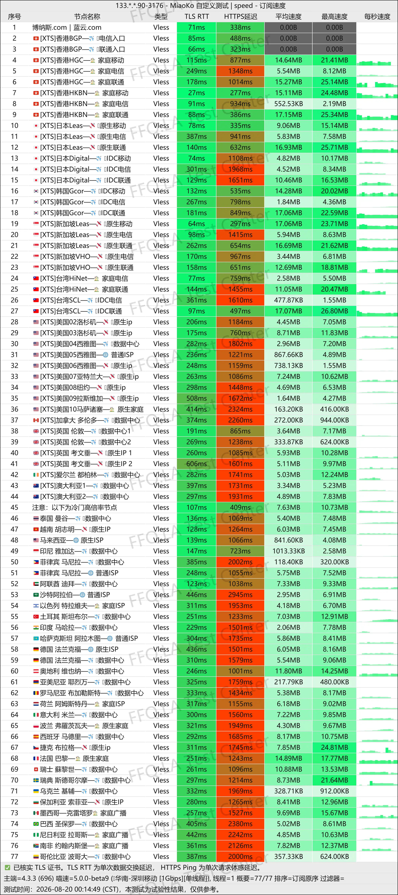
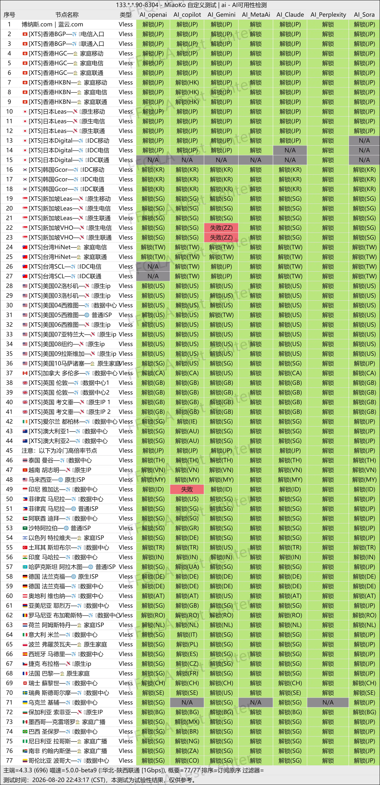
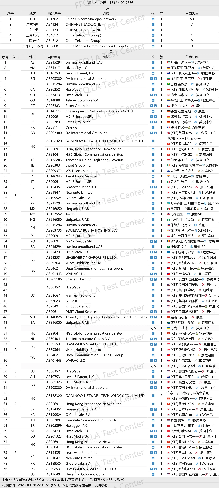

 🇨🇳 [中文](README.md) | 🇺🇸 [English](README_EN.md) | 🇷🇺 [Русский](README_RU.md) | 🇮🇷 فارسی

# وب‌سایت رسمی LanYun VPN (به‌روزرسانی ۲ نوامبر ۲۰۲۶)

وب‌سایت رسمی LanYun VPN<br>
آخرین آدرس ۰۱: [https://lanyun.org](https://to.iix.im/lan01)<br>
آخرین آدرس ۰۲: [https://lanyun.xyz](https://to.iix.im/lan02)<br>
آدرس رسمی ۰۱: [https://蓝云.com](https://to.iix.im/lan03)<br>
آدرس رسمی ۰۲: [https://博纳斯.com](https://to.iix.im/lan04)<br>

معرفی بهترین سرویس‌ها و سرورهای VPN در سال ۲۰۲۶: [https://github.com/jdnei/JiChangTuiJian](https://github.com/jdnei/JiChangTuiJian)<br>

## انجمن و پیشنهادهای ویژه VPN در تلگرام #AD
[قرعه‌کشی VPN](https://331024.de/archives/choujiang) | [گروه گفت‌وگوی VPN](https://331024.de/archives/choujiang) | [گروه آزمایش VPN](https://331024.de/archives/choujiang)<br>

[https://331024.de/archives/choujiang](https://331024.de/archives/choujiang)

## کد دعوت
`با ثبت‌نام از طریق لینک ارائه‌شده، یک طرح آزمایشی به‌صورت خودکار دریافت می‌کنید. ارائه‌دهنده ممکن است این پیشنهاد را در هر زمانی لغو کند.`

## کد تخفیف
```bash
lanyun2026
```

## معرفی
LanYun VPN که با نام Bona Blue Cloud نیز شناخته می‌شود، یک ارائه‌دهنده خدمات افزایش سرعت شبکه است که بر خطوط اختصاصی سازمانی و سرورهای مستقر در مناطق مختلف تمرکز دارد.

این سرویس برای فعالیت‌های تجاری بین‌المللی، دورکاری فرامرزی، تجارت خارجی، سرگرمی و تماشای ویدئوهای آنلاین و افزایش سرعت دسترسی روزمره به اینترنت طراحی شده است.

LanYun از دستگاه‌های Windows، macOS، Android و iOS پشتیبانی می‌کند و نرم‌افزارهای اختصاصی خود را نیز ارائه می‌دهد.

تمرکز اصلی این سرویس بر پایداری اتصال، سهولت استفاده و ارائه خدمات قابل‌اعتماد در بلندمدت است.

## مزایا
مهم‌ترین مزایای LanYun VPN شامل خطوط اختصاصی سازمانی، پوشش گسترده سرورها در مناطق مختلف و ارائه نرم‌افزارهای اختصاصی است که فرایند راه‌اندازی و تنظیمات را ساده‌تر می‌کنند.

تنوع بالای مکان‌های سرور، استفاده از این سرویس را برای فعالیت‌های تجاری بین‌المللی، تجارت خارجی، پلتفرم‌های پخش آنلاین، ابزارهای هوش مصنوعی و دستگاه‌های مختلف امکان‌پذیر می‌سازد.

LanYun به‌ویژه برای کاربرانی مناسب است که پایداری شبکه، سهولت کاربری و کیفیت مستمر خدمات در بلندمدت را در اولویت قرار می‌دهند.

## طرح‌های اشتراک

| طرح | حجم ترافیک | قیمت | تعداد دستگاه | شبکه / سرورها | ویژگی‌های اصلی |
| --- | ---: | --- | ---: | --- | --- |
| 💎 طرح الماس SVIP | 1024 GB/ماه | ماهانه ¥58 / سه‌ماهه ¥165 / شش‌ماهه ¥313 / سالانه ¥650 | 20 | بیش از ۵۰ سرور با خطوط اختصاصی IEPL | تخفیف سالانه اعلام‌شده ۲۰٪؛ دسترسی به خدمات AI در تمام سرورها؛ رفع محدودیت Netflix / HBO / Hulu و سایر سرویس‌های پخش آنلاین |
| 🏆 طرح سازمانی SVIP A | 2048 GB/ماه | ماهانه ¥108 / سه‌ماهه ¥291 / شش‌ماهه ¥580 / سالانه ¥1200 | 100 | تمام سرورها + خطوط اختصاصی IPLC سازمانی | تخفیف سالانه اعلام‌شده ۲۵٪؛ لینک اشتراک اختصاصی؛ پشتیبانی از تمام پلتفرم‌ها؛ طرح پوشش جهانی؛ انتخاب مناطق سفارشی؛ پشتیبانی اختصاصی مشتریان |
| 🏆 طرح سازمانی SVIP S | 4096 GB/ماه | ماهانه ¥188 / سه‌ماهه ¥507 / شش‌ماهه ¥902 / سالانه ¥2200 | 200 | تمام سرورها + خطوط اختصاصی IPLC سازمانی | تخفیف سالانه اعلام‌شده ۲۵٪؛ لینک اشتراک اختصاصی؛ پشتیبانی از تمام پلتفرم‌ها؛ طرح پوشش جهانی؛ انتخاب مناطق سفارشی؛ پشتیبانی اختصاصی مشتریان |
| 🎖️ پلاتینیوم VIP سالانه (نسخه ارتقایافته) | 600 GB/ماه | سالانه ¥388 | 18 | بیش از ۵۰ مسیر رله پرسرعت | دسترسی به خدمات AI در تمام سرورها؛ رفع محدودیت Netflix / HBO / Hulu و سایر سرویس‌های پخش آنلاین؛ بازگشت وجه از طریق معرفی کاربران در سراسر سایت |
| 🎖️ طرح پلاتینیوم VIP | 512 GB/ماه | ماهانه ¥35 / سه‌ماهه ¥99 / شش‌ماهه ¥188 / سالانه ¥410 | 12 | بیش از ۵۰ مسیر رله پرسرعت | دسترسی به خدمات AI در تمام سرورها؛ رفع محدودیت Netflix / HBO / Hulu و سایر سرویس‌های پخش آنلاین |
| طلایی VIP (نسخه ارتقایافته) | 256 GB/ماه | شش‌ماهه ¥145 / سالانه ¥290 | 7 | بیش از ۳۰ مسیر رله پرسرعت | دسترسی به خدمات AI در تمام سرورها؛ رفع محدودیت Netflix / HBO / Hulu و سایر سرویس‌های پخش آنلاین |
| برنزی سالانه (نسخه ارتقایافته) | 28 GB/ماه | سالانه ¥168 | 3 | بیش از ۲۰ مسیر پیشرفته | فقط قابل استفاده با نرم‌افزار رسمی؛ امکان کسر ارزش باقی‌مانده هنگام تغییر طرح؛ بازگشت وجه از طریق معرفی کاربران در سراسر سایت |
| Overseas Package A | 500 GB/ماه | ماهانه ¥45 / سه‌ماهه ¥135 / شش‌ماهه ¥243 / سالانه ¥450 | 9 | بیش از ۵۰ منطقه در جهان / بیش از ۱۰۰ سرور | تخفیف سالانه اعلام‌شده ۲۰٪؛ کاربران سرزمین اصلی چین نباید این طرح را خریداری کنند؛ سرویس در سرزمین اصلی چین قابل استفاده نیست و وجه پرداختی بازگردانده نمی‌شود |
| Overseas Package S | 2000 GB/ماه | ماهانه ¥118 / سه‌ماهه ¥354 / شش‌ماهه ¥637 / سالانه ¥1180 | 18 | بیش از ۵۰ منطقه در جهان / بیش از ۱۰۰ سرور | تخفیف سالانه اعلام‌شده ۲۰٪؛ کاربران سرزمین اصلی چین نباید این طرح را خریداری کنند؛ سرویس در سرزمین اصلی چین قابل استفاده نیست و وجه پرداختی بازگردانده نمی‌شود |
| بسته ترافیک 240G بدون انقضا | مجموع 240 GB | پرداخت یک‌باره ¥88 | 5 | بیش از ۵۰ مسیر پرسرعت | بدون تاریخ انقضا؛ معتبر تا پایان حجم ترافیک؛ پاداش معرفی کاربران در سراسر سایت |
| بسته پیشرفته 900G با دسترسی به تمام سرورها | مجموع 900 GB | پرداخت یک‌باره ¥288 | 10 | بیش از ۸۰ مسیر پرسرعت | بدون تاریخ انقضا؛ مسیرهای طرح پوشش جهانی؛ پاداش معرفی کاربران در سراسر سایت |
| بسته پیشرفته 1800G با دسترسی به تمام سرورها | مجموع 1800 GB | پرداخت یک‌باره ¥488 | 20 | بیش از ۸۰ مسیر پرسرعت | بدون تاریخ انقضا؛ مسیرهای طرح پوشش جهانی؛ پاداش معرفی کاربران در سراسر سایت |
| بسته پیشرفته 3000G با دسترسی به تمام سرورها | مجموع 3000 GB | پرداخت یک‌باره ¥688 | 40 | بیش از ۸۰ مسیر پرسرعت | بدون تاریخ انقضا؛ مسیرهای طرح پوشش جهانی؛ پاداش معرفی کاربران در سراسر سایت |

> توجه: بسته‌های ترافیک یک‌باره تاریخ انقضا ندارند و تا زمانی که حجم خریداری‌شده به پایان برسد معتبر هستند. این بسته‌ها برای استفاده گاه‌به‌گاه یا کم‌مصرف مناسب‌اند. امکان تجمیع حجم ترافیک وجود ندارد.

## 📊 آزمایش عملکرد و تحلیل

#### 1. آزمایش سرعت در ساعات اوج مصرف شبانه
<br>

#### 2. گزارش رفع محدودیت سرویس‌های پخش آنلاین
<br>

#### 3. تحلیل سرورهای ورودی و خروجی
<br>
