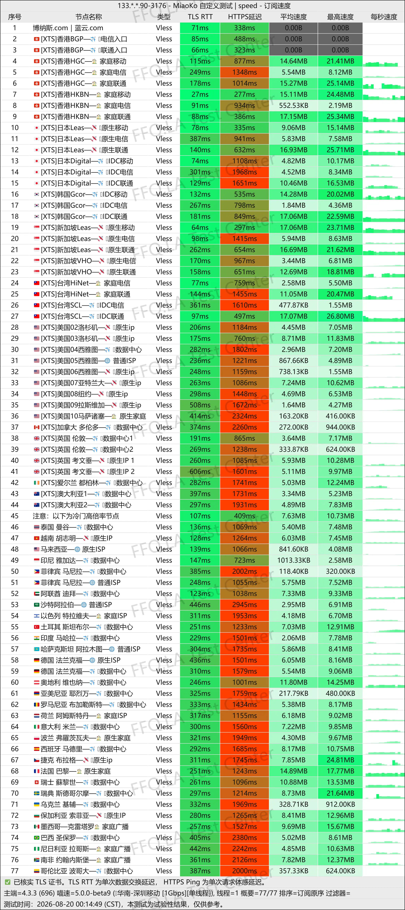
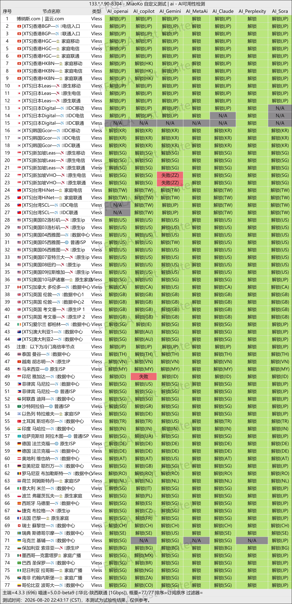
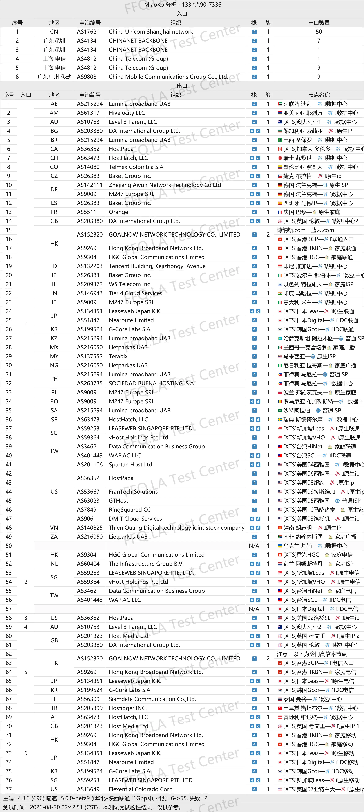

🇨🇳 [中文](README.md) | 🇺🇸 [English](README_EN.md) | 🇷🇺 Русский | 🇮🇷 [فارسی](README_FA.md)

# Официальный сайт LanYun VPN (обновлено 9 ноября 2026)

Официальный сайт LanYun VPN<br>
Актуальный адрес 01: [https://lanyun.org](https://to.iix.im/lan01)<br>
Актуальный адрес 02: [https://lanyun.xyz](https://to.iix.im/lan02)<br>
Официальный адрес 01: [https://蓝云.com](https://to.iix.im/lan03)<br>
Официальный адрес 02: [https://博纳斯.com](https://to.iix.im/lan04)<br>

Лучшие VPN-сервисы и серверы на 2026 год: [https://github.com/jdnei/JiChangTuiJian](https://github.com/jdnei/JiChangTuiJian)<br>

## Telegram: VPN-сообщество и специальные предложения #AD
[Розыгрыши VPN](https://331024.de/archives/choujiang) | [Чат о VPN](https://331024.de/archives/choujiang) | [Группа тестирования VPN](https://331024.de/archives/choujiang)<br>

[https://331024.de/archives/choujiang](https://331024.de/archives/choujiang)

## Пригласительный код
`При регистрации по предоставленной ссылке автоматически выдаётся пробный тариф. Провайдер может отменить эту акцию в любое время.`

## Промокод / Код скидки
```bash
lanyun2026
```

## Обзор
LanYun VPN, также известный как Bona Blue Cloud, — провайдер услуг ускорения сетевых соединений, специализирующийся на выделенных линиях корпоративного уровня и серверах в различных регионах.

Сервис предназначен для международного бизнеса, трансграничной удалённой работы, внешней торговли, потокового видео, развлечений и повседневного ускорения интернет-соединений.

LanYun поддерживает устройства на Windows, macOS, Android и iOS, а также предоставляет собственные клиентские приложения.

Основное внимание уделяется стабильности соединения, простоте использования и надёжной долгосрочной работе сервиса.

## Преимущества
Главные преимущества LanYun VPN — выделенные линии корпоративного уровня, широкое географическое покрытие серверов и собственные клиентские приложения, упрощающие процесс настройки.

Разнообразие серверных локаций позволяет использовать сервис для международного бизнеса, внешней торговли, стриминговых платформ, инструментов искусственного интеллекта и работы на нескольких устройствах.

LanYun особенно подходит пользователям, которые ценят стабильность сети, удобство управления и постоянное качество обслуживания при длительном использовании.

## Тарифные планы

| Тариф | Трафик | Цена | Устройства | Сеть / Серверы | Основные возможности |
| --- | ---: | --- | ---: | --- | --- |
| 💎 Бриллиантовый SVIP | 1024 ГБ/мес. | Месяц ¥58 / Квартал ¥165 / Полгода ¥313 / Год ¥650 | 20 | Более 50 серверов с выделенными линиями IEPL | Заявленная годовая скидка 20%; доступ к AI на всех серверах; разблокировка Netflix / HBO / Hulu и других стриминговых сервисов |
| 🏆 Корпоративный SVIP A | 2048 ГБ/мес. | Месяц ¥108 / Квартал ¥291 / Полгода ¥580 / Год ¥1200 | 100 | Все серверы + выделенные линии IPLC корпоративного уровня | Заявленная годовая скидка 25%; отдельный URL подписки; поддержка всех платформ; программа глобального покрытия; настройка регионов; персональная поддержка |
| 🏆 Корпоративный SVIP S | 4096 ГБ/мес. | Месяц ¥188 / Квартал ¥507 / Полгода ¥902 / Год ¥2200 | 200 | Все серверы + выделенные линии IPLC корпоративного уровня | Заявленная годовая скидка 25%; отдельный URL подписки; поддержка всех платформ; программа глобального покрытия; настройка регионов; персональная поддержка |
| 🎖️ Платиновый VIP на год (улучшенный) | 600 ГБ/мес. | Год ¥388 | 18 | Более 50 высокоскоростных ретрансляционных маршрутов | Доступ к AI на всех серверах; разблокировка Netflix / HBO / Hulu и других стриминговых сервисов; возврат части средств за приглашения по всему сайту |
| 🎖️ Платиновый VIP | 512 ГБ/мес. | Месяц ¥35 / Квартал ¥99 / Полгода ¥188 / Год ¥410 | 12 | Более 50 высокоскоростных ретрансляционных маршрутов | Доступ к AI на всех серверах; разблокировка Netflix / HBO / Hulu и других стриминговых сервисов |
| Золотой VIP (улучшенный) | 256 ГБ/мес. | Полгода ¥145 / Год ¥290 | 7 | Более 30 высокоскоростных ретрансляционных маршрутов | Доступ к AI на всех серверах; разблокировка Netflix / HBO / Hulu и других стриминговых сервисов |
| Бронзовый годовой (улучшенный) | 28 ГБ/мес. | Год ¥168 | 3 | Более 20 премиальных маршрутов | Только официальный клиент; остаточная стоимость может учитываться при смене тарифа; возврат части средств за приглашения по всему сайту |
| Overseas Package A | 500 ГБ/мес. | Месяц ¥45 / Квартал ¥135 / Полгода ¥243 / Год ¥450 | 9 | Более 50 регионов мира / более 100 серверов | Заявленная годовая скидка 20%; пользователям из материкового Китая покупать запрещено — сервис там не работает, возврат средств не предусмотрен |
| Overseas Package S | 2000 ГБ/мес. | Месяц ¥118 / Квартал ¥354 / Полгода ¥637 / Год ¥1180 | 18 | Более 50 регионов мира / более 100 серверов | Заявленная годовая скидка 20%; пользователям из материкового Китая покупать запрещено — сервис там не работает, возврат средств не предусмотрен |
| Пакет 240G без срока действия | Всего 240 ГБ | Разовая оплата ¥88 | 5 | Более 50 высокоскоростных маршрутов | Без срока действия; действует до исчерпания трафика; бонусы за приглашения по всему сайту |
| Премиальный пакет 900G со всеми серверами | Всего 900 ГБ | Разовая оплата ¥288 | 10 | Более 80 высокоскоростных маршрутов | Без срока действия; маршруты программы глобального покрытия; бонусы за приглашения по всему сайту |
| Премиальный пакет 1800G со всеми серверами | Всего 1800 ГБ | Разовая оплата ¥488 | 20 | Более 80 высокоскоростных маршрутов | Без срока действия; маршруты программы глобального покрытия; бонусы за приглашения по всему сайту |
| Премиальный пакет 3000G со всеми серверами | Всего 3000 ГБ | Разовая оплата ¥688 | 40 | Более 80 высокоскоростных маршрутов | Без срока действия; маршруты программы глобального покрытия; бонусы за приглашения по всему сайту |

> Примечание: Разовые пакеты трафика не имеют срока действия и остаются действительными до полного исчерпания приобретённого объёма. Они подходят для редкого или нерегулярного использования. Объёмы трафика нельзя суммировать.

## 📊 Тесты производительности и анализ

#### 1. Тест скорости в вечерние часы пик
<br>

#### 2. Отчёт о разблокировке стриминговых сервисов
<br>

#### 3. Анализ входных и выходных узлов
<br>
